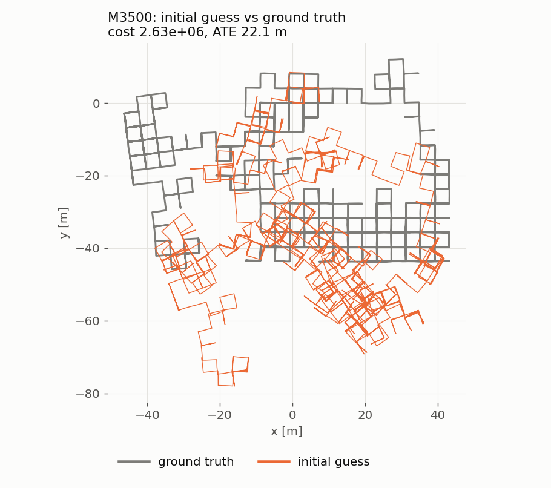
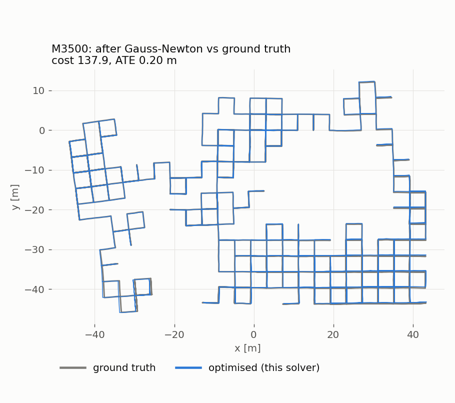
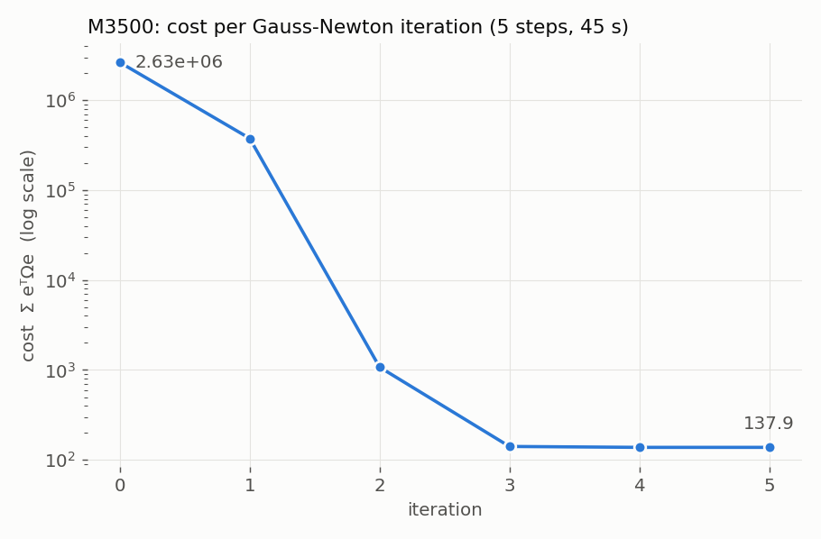

# Pose Graph Optimization Learning

## Journey

In this age of AI, LLMs and vibe coding, I am a big believer in coding things up yourself, especially when it comes to learning concepts or new algorithms, and using LLMs or agents as highly skilled assistants in development. That being said, I set myself out to learn the wonders of SLAM backend optimization. 

SLAM being the field I really genuinely wanted to focus on, I started with the "14 Lectures on Visual SLAM" (by Xiang Gao, Tao Zhang, Yi Liu, Qinrui Yan) [1] where I first learned that SLAM also had such a thing as a frontend and backend similar to web development. The frontend would usually be in charge of constructing some sort of pose graph prone to drift while it was the job of the backend to actually optimize the overall trajectory obtained from the frontend via the pose graph and minimize the cost from its actual path as much as possible.

Thus began my fascination with the subject and as I went deeper I found out about Pose Graph Optimization and how that was one of the main methods to optimizing these trajectories. After countless Googling of "pose graph optimization from scratch in python", going through the mathematical basics of the 14 lectures and skipping to the optimization section of it, I finally came across "A Tutorial on Graph-Based SLAM" (by Giorgio Grisetti, Rainer Kümmerle, Cyrill Stachniss, Wolfram Burgard) [2] which provided a really direct entry into the topic. The probability theory and batch estimation section of "State Estimation for Robotics" (by Timothy D. Barfoot) [3] really helped in understanding how Grisetti et al. got towards the negative log likelihood from which they formed the objective function. It also really helped taking Group Theory in my undergrad as it paved the way for how optimization can be carried out on a manifold and how these mathematical abstractions can be used effectively in a real world setting. 

Personally for me, if I want to understand really rigorously, I have to write it down as elaborately as possible with a pen and paper and that is precisely what I did for understanding this from head to toe. These can be seen in [handwritten_notes/pose_graph_optimization_notes.pdf](handwritten_notes/pose_graph_optimization_notes.pdf) where I had essentially derived the entire problem formulation first from simple probability maximization of

$$
\mathbf{x}^* = \underset{\mathbf{x}}{\arg\max}\; p(\mathbf{x} \mid \mathbf{z}, \mathbf{u})
$$

to the creation of the objective function

$$
F(\mathbf{x}) = \sum_{\langle i,j \rangle} \mathbf{e}_{ij}^\top \, \boldsymbol{\Omega}_{ij} \, \mathbf{e}_{ij}
$$

Afterwards to actually solve for that, we'd Taylor expand the error function with respect to some delta:

$$
\mathbf{e}_{ij}(\mathbf{x} + \Delta\mathbf{x}) \approx \mathbf{e}_{ij} + \mathbf{J}_{ij} \, \Delta\mathbf{x}
$$

Then, applying that expansion to the objective, we obtain a quadratic of $\Delta\mathbf{x}$ which we have to solve for:

$$
F(\mathbf{x} + \Delta\mathbf{x}) \approx c + 2\,\mathbf{b}^\top \Delta\mathbf{x} + \Delta\mathbf{x}^\top \mathbf{H} \, \Delta\mathbf{x},
\qquad
\mathbf{H} = \sum_{\langle i,j \rangle} \mathbf{J}_{ij}^\top \boldsymbol{\Omega}_{ij} \mathbf{J}_{ij},
\qquad
\mathbf{b} = \sum_{\langle i,j \rangle} \mathbf{J}_{ij}^\top \boldsymbol{\Omega}_{ij} \mathbf{e}_{ij}
$$

We do this by taking the derivative of the objective with respect to $\Delta\mathbf{x}$ and setting it to zero, which gives

$$
\mathbf{H} \, \Delta\mathbf{x}^* = -\mathbf{b}
$$

After solving for $\Delta\mathbf{x}^*$, we apply it to the poses and repeat until the cost stops decreasing. In the vector case we simply add it,

$$
\mathbf{x} \leftarrow \mathbf{x} + \Delta\mathbf{x}^*
$$

and in the manifold case we use the boxplus operator on each pose:

$$
\mathbf{X}_k \leftarrow \mathbf{X}_k \boxplus \Delta\mathbf{x}_k^* = \mathbf{X}_k \operatorname{Exp}(\Delta\mathbf{x}_k^*)
$$

This derivation was done for both the vector case and the manifold case. 

The problem arises in actually solving for $\Delta\mathbf{x}$ as this requires the construction of the Hessian, which further requires the jacobian. This is especially difficult in the manifold case. In Grisetti's paper, they converted to quaternions to more simply obtain the jacobians, but being as stubborn as I am, I decided I wanted to deal with $SE(n)$, $n \in \{2, 3\}$ only. Thus, I set out on my adventures of perpetual hair pulling, head banging and really honestly trying to understand and internalize the math whose final product can be properly seen in my notes. 

Finally after properly embedding everything in my mind, all that was left was implementation. I started with writing a Lie theory based library called Lee. In my efforts to make it as general as possible for N dimensions, I found that that would actually add little to no benefit and would instead add more time to actually solving the problem from computation load and checking. And after rigorously testing the library, it was time for the real deal in writing the actual solver.

When writing the solver, I ended up writing a base Solver class which other solver classes like Gauss-Newton or LM will inherit from. This would allow me to put repeated features like g2o dataset parsing or results comparisons/plotting in the base class and separate the main solving method. 

I naively thought that the default cho_factor solver used sparse matrices, which is what the Hessian was. While Cholesky Factorization works on any symmetric positive definite matrix, dense or sparse (which is also why one pose has to be fixed: without that anchor the Hessian is only positive semi-definite and the factorization fails), scipy's cho_factor is the dense version and took a dense matrix and the way I would initialize the Hessian with all zeroes would not actually programmatically make the matrix sparse. Zeroes are still numbers. From this, I found out about actually sparsely constructing the Hessian and using CHOLMOD as the sparse solver (which is still Cholesky Factorization).

Now finally having constructed a Gauss Newton Solver, it was time to run tests and see how it actually performs.

## Results

I compared my own backend results with a GTSAM version with the same solver to see how my own implementation performed with respect to it. GTSAM had a maximum loop count of 20 iterations (40 for M3500a, see below) and my solver had a maximum of 40; apart from M3500a, every run converged within 6 steps, so these limits never came into play. For the $SE(3)$ datasets, the rotation scaling factor in my g2o parser (which follows g2o's quaternion error convention) was disabled so that both solvers minimise exactly the same cost; with it enabled, my solver reports a differently scaled cost for $SE(3)$ (e.g. 727.3 instead of 1351.4 on sphere2500). Solve times exclude loading the file, for both implementations; my parse time is shown separately in brackets.

| Dataset | Type | Steps (this / GTSAM) | Final cost, this solver | Final cost, GTSAM | Max pose difference | Solve time, this solver (+ parse) | Solve time, GTSAM | GTSAM faster by |
|---|---|---|---|---|---|---|---|---|
| intel | SE(2) | 3 / 3 | 4.500423e+01 | 4.500423e+01 | 3.6e-06 m, 2.2e-05° | 14.5 s (+0.7 s) | 0.11 s | ~130× |
| M3500 | SE(2) | 5 / 5 | 1.379149e+02 | 1.379149e+02 | 1.0e-05 m, 3.6e-04° | 44.0 s (+1.1 s) | 0.37 s | ~120× |
| M3500a | SE(2) | 25 / 25 | 7.756562e+03 | 7.756562e+03 | 1.3e-06 m, 7.1e-05° | 209.9 s (+1.4 s) | 1.69 s | ~125× |
| city10000 | SE(2) | 6 / 6 | 5.119875e+02 | 5.119875e+02 | 3.1e-06 m, 1.8e-04° | 195.5 s (+4.5 s) | 1.76 s | ~110× |
| sphere2500 | SE(3) | 6 / 6 | 1.351402e+03 | 1.351402e+03 | 1.0e-12 m, 6.7e-13° | 45.5 s (+1.8 s) | 1.24 s | ~37× |
| parking-garage | SE(3) | 4 / 4 | 1.268385e+00 | 1.268385e+00 | 4.0e-11 m, 1.1e-11° | 39.0 s (+2.1 s) | 0.33 s | ~120× |

From the table, we can see that both implementations solve very similarly going to similar costs and steps. The only eye-catching difference is the time taken for both implementations. GTSAM would take much less time than my own implementation did. This is due to a variety of factors, one of the biggest being the languages written. My implementation being written in python will understandably cause issues with speed. Another big issue is that calculations are done in loops, rather possibly doing them all as a single stacked batch matrix would possibly reduce the speed issues by a great deal.

Apart from this it can be seen that for M3500a, the convergence took more than 20 iterations. This was true for both solvers and GTSAMs LM implementation only reduced iteration by one. Initially after seeing the fail to convergence, I bumped up the max loop count to 40 iterations rather than 20 and observed that GTSAM GN and my own GN returned a final cost at 25 iterations and LM at 24 with all having similar final costs. Once again, the only major issue being that my implementation took a massive 209.9 seconds (plus 1.4 seconds of parsing) as opposed to GTSAM GN taking 1.69 seconds. 

Overall we can see that my own implementation agrees with GTSAMs implementation in both $SE(3)$ and $SE(2)$ in terms of both steps and final cost. The only disagreement is in time taken to convergence which is more of an engineering issue than anything. 

The figures below show M3500 being solved by my own implementation. The ground truth trajectory comes from the M3500 ground truth file distributed with the [RA-iSAM2](https://github.com/ucb-bar/ra-isam2) datasets; consistent with it being the true trajectory, its cost under my objective (147.0) is slightly higher than the optimum my solver finds (137.9), as expected with noisy measurements. Both estimates are aligned to the ground truth by their first pose.

The initial guess (orange) is 22.1 m RMSE away from the ground truth (grey).

After 5 Gauss-Newton steps, my solver's estimate (blue) lies almost on top of the ground truth, 0.20 m RMSE away.

The cost drops from 2.63e6 to 137.9 in 5 steps, with most of the reduction in the first three.

My implementation was also run on harder datasets such as MIT, INTEL (the 1,228-pose version, not the intel in the table above), M3500b/c, ais2klinik, sphere_bignoise_vertex3, torus3D and grid3D, but it failed on them, the same was true for the GTSAM-GN implementation, while GTSAM's LM solves most of them. My educated guess is that I need to do a LM solver implementation to solve those. 

## References

1. X. Gao, T. Zhang, Y. Liu, Q. Yan, *14 Lectures on Visual SLAM: From Theory to Practice*, Publishing House of Electronics Industry, 2017. English translation: X. Gao, T. Zhang, *Introduction to Visual SLAM: From Theory to Practice*, 2021, [github.com/gaoxiang12/slambook-en](https://github.com/gaoxiang12/slambook-en).
2. G. Grisetti, R. Kümmerle, C. Stachniss, W. Burgard, "A Tutorial on Graph-Based SLAM", *IEEE Intelligent Transportation Systems Magazine*, vol. 2, no. 4, pp. 31–43, 2010.
3. T. D. Barfoot, *State Estimation for Robotics*, 2nd ed., Cambridge University Press, 2024.